# Little Tree user guide

**A little care, every day.**

Little Tree brings the kindergarten day into one calm, connected place. Principals organize the school, teachers share and manage the day, and parents stay close to their child's experience. Start with **Today**, then use the sidebar for a specific task.

> **About this version:** Little Tree is a working local demo with fictional families and school records. Role switching demonstrates different views; it is not secure sign-in. Progress is saved in your browser, and updates synchronize between tabs in the same browser profile and at the same address. It is not ready for real children's information or real pickup operations.

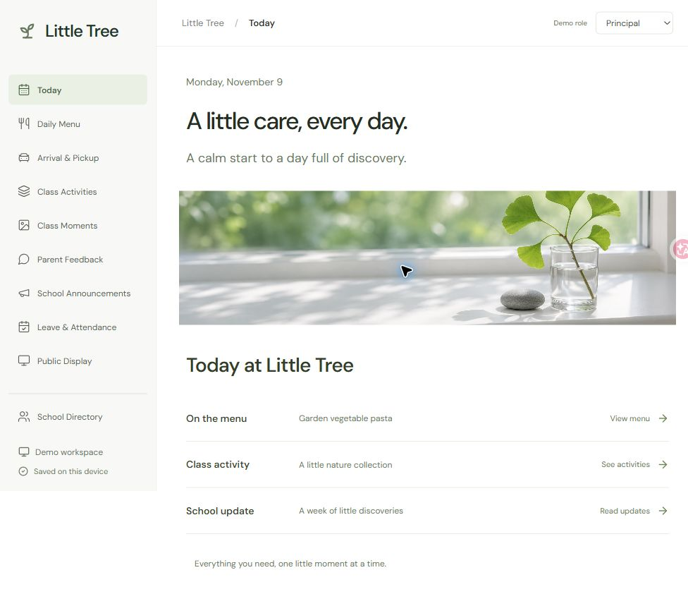

*Today keeps the essentials close: the menu, a class activity, and a school update.*

## Find your way

- [Install and launch](#install-and-launch)
- [Choose a role](#choose-a-role)
- [The main features](#the-main-features)
- [Editing and publishing](#editing-and-publishing)
- [Daily Menu](#daily-menu)
- [Arrival and Pickup](#arrival-and-pickup)
- [Class Activities](#class-activities)
- [Class Moments](#class-moments)
- [Parent Feedback](#parent-feedback)
- [School Announcements](#school-announcements)
- [Leave and Attendance](#leave-and-attendance)
- [School Directory and My Child](#school-directory-and-my-child)
- [Public Display](#public-display)
- [Saved progress](#saved-progress)
- [Help with common problems](#help-with-common-problems)

## Install and launch

### First time on a new Windows computer

If this copy already runs, skip to **Start your day** below.

1. Copy or extract the **complete `little-tree` folder** to your computer. Keep its files together, including `src`, `public`, `scripts`, `package.json`, and `package-lock.json`. Copying only the HTML files will not work.
2. Install **Node.js LTS, version 22.12 or newer**, from the [official Node.js download page](https://nodejs.org/en/download). Choose the Windows installer and follow its setup steps. Close and reopen any terminal after installation.
3. Open the `little-tree` folder in File Explorer. Click the address bar, type `powershell`, and press **Enter**. This opens a terminal in the right folder.
4. Check Node.js and install the project's dependencies:

   ```powershell
   node --version
   npm.cmd ci
   ```

   **Success:** the first command prints a supported version; installation finishes without errors. `npm.cmd ci` downloads packages from npm and replaces the installed dependency folder. It does not clear the app's saved browser records.
5. Close this terminal and follow the launcher steps below. The application does not need a separate installer.

### Start your day

1. Double-click **`Start Little Tree.cmd`** inside the project folder.
2. Wait for **“Little Tree is ready”** or **“Little Tree is already running.”** The launcher opens the portal and TV board in Microsoft Edge. If it cannot open Edge automatically, use the addresses it prints:

   | Page | Local address |
   | --- | --- |
   | Staff and parent portal | [Open Little Tree](http://127.0.0.1:5173/) |
   | Public TV board | [Open Public Display](http://127.0.0.1:5173/display.html) |

3. Keep the launcher window open if it started a new server. Keep a portal tab open to supply public-board updates and scheduled announcements.
4. Use both pages in the **same Edge profile** and keep the exact `127.0.0.1:5173` address.

**Success:** the portal shows **Today**, as pictured above. The TV board shows today's published menu and selected schedules; approved notices appear after staff select them.

To stop a server started by the launcher, press **Ctrl+C** in its window. Saved browser records remain. When the launcher reuses an existing server, closing the new launcher window does not stop that existing server.

### Why the local server matters

Little Tree's HTML files load a React application and its JavaScript modules. They need the local server to prepare and serve those files correctly. Opening `index.html` or `display.html` directly with a `file://` address shows **“Open Little Tree with the local launcher”** instead of the application.

Use the launcher; do not disable browser security. The server listens only on this computer. Starting it does not deploy the app or make it accessible on another device.

## Choose a role

Use **Demo role** at the top right. Teachers choose their account under **Viewing as**; parents choose a child under **Family of**. Switching roles returns you to **Today**, so reopen the section you need.

| Role | A typical day | Demo starting point |
| --- | --- | --- |
| **Principal** | Manage classes and students, oversee attendance, publish school-wide notices, and approve public TV content. | Olivia Parker; all three classes. |
| **Teacher** | Record arrivals, review leave, confirm pickup, share class activities and moments, and answer families. | Emma Wilson; Seedlings. |
| **Parent** | Check published updates, arrange pickup, send activity responses, request leave, and privately contact staff. | Ava Bennett's account; Sarah Bennett is the fictional parent. |

For a connected walkthrough, use **Teacher → Emma Wilson** and **Parent → Ava Bennett**. Their class is Seedlings. Select a different family to explore how the parent view changes.

**Success:** the role and account labels match your choice; available actions and class content change with them. These selectors are demonstration controls, not passwords or real account protection.

## The main features

| Section | What you will find |
| --- | --- |
| **Today** | A welcome and three useful updates for the day. |
| **Daily Menu** | Breakfast, lunch, dinner, snacks, dish photos, and allergen information. |
| **Arrival & Pickup** | Arrival status, authorized contacts, pickup arrangements, the queue, and staff handover confirmation. |
| **Class Activities** | Daily instructions, materials, take-home tasks, deadlines, and private family responses. |
| **Class Moments** | Class stories, artwork and photos, teacher moderation, and comments. |
| **Parent Feedback** | Private questions, suggestions, or concerns with replies and status history. |
| **School Announcements** | Published or scheduled notices, urgent updates, attachments, and read confirmations. |
| **Leave & Attendance** | Leave requests, staff decisions, and connected attendance records. |
| **Public Display** | Staff controls for the kindergarten's public notice board. |
| **School Directory / My Child** | Staff class and student information, or the family's child profile and attendance history. |

## Editing and publishing

Most editing happens in a consistent dialog. Required fields must be complete before a change can be saved. If an error appears, correct the highlighted information and try again.

| Action | What it means |
| --- | --- |
| **Add / Edit** | Open a form to create or update a record. |
| **Save Draft** | Keep work for later. It is not newly published to families. Menu drafts preserve the previous published menu. |
| **Publish** | Make the completed item available to its intended audience. |
| **Schedule** | Hold an announcement for its chosen publication time. |
| **Save arrangement / Submit response / Send reply** | Save that specific workflow immediately; no separate Publish step is needed. |
| **Delete** | Remove the selected item after any confirmation shown. There is no general undo or recycle bin. Menu deletion affects the draft until publication. |
| **Cancel / Close dialog** | Leave the form without saving its unsaved edits. |

**Photo and attachment limits:** use JPEG, PNG, or WebP for photos, up to **8 MB** each. Announcement attachments also accept PDF up to **8 MB**. Wait for processing to finish before saving. Files stay in this browser's local storage. Native file-picker labels follow Windows or browser language settings.

## Daily Menu

### Staff: edit a dish and publish the day

1. Choose **Principal** or **Teacher**, then open **Daily Menu**.
2. Set **Menu date**. Select **Add dish**, or **Edit** beside an existing dish.
3. Choose Breakfast, Lunch, Dinner, or Snacks. Enter the dish name, description, and allergens. Use **Dish photo** for an optional image.
4. Select **Save Draft**. Review the day's dishes on the menu page.
5. Select **Publish** when the whole day's menu is ready.

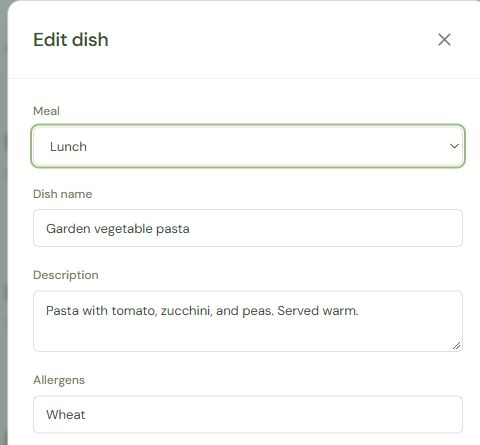

*Detail view of the dish fields. The photo control and Save Draft action are below these fields in the dialog.*

**Success:** the menu is marked **Published**. Switch to Parent, reopen the same date, and check that the updated dishes appear. Before publication, parents continue to see the previous published version.

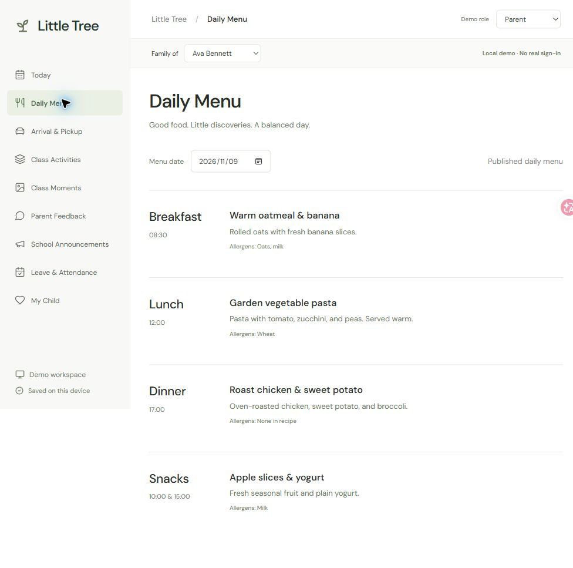

*Parents see the published menu without staff editing controls.*

### Reuse or remove menu content

- **Copy menu:** select your destination date, choose **Copy menu**, select a previous menu date, and choose **Copy to draft**. Review the copied dishes, then **Publish**. Copying replaces the destination draft, so check the date first.
- **Delete a dish:** choose its **Delete** action and confirm. Publish the menu to make that removal visible to families.
- **Unpublish menu:** hide the published menu while keeping the draft available to staff.

When **Show menu** is enabled in Public Display, today's published menu also feeds the TV board. Future menus wait until their date; drafts never appear there.

## Arrival and Pickup

The parent saves a plan; staff record arrival and confirm the eventual handover. Joining the queue is a notification to staff, not proof that pickup has happened.

### Parent: arrange pickup

1. Choose your child's account and open **Arrival & Pickup → Manage pickup**.
2. Review **Authorized pickup contacts**. If needed, choose **Add contact** and enter a fictional name, relationship, and phone number. A parent-added contact starts **Pending**.
3. Ask staff to review the contact. In the demo, switch to the child's teacher, open the child's **Details**, and choose **Authorize** or **Decline**.
4. Back in the parent view, choose an authorized **Pickup contact**, set **Expected pickup time**, and add an optional **Note for staff**.
5. Choose **Save arrangement**.

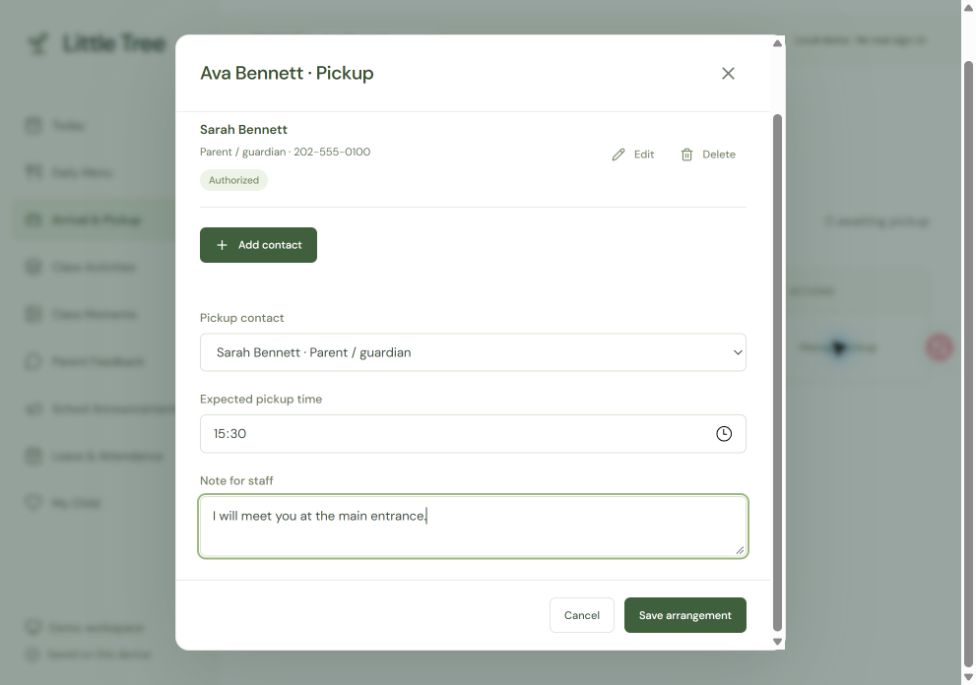

**Success:** the child's row shows the selected contact and time. Editing a contact invalidates unfinished arrangements using that contact; parents need fresh authorization and a newly saved plan.

### Teacher and parent: complete the journey

1. As the teacher, open today's **Arrival & Pickup** page and choose **Record arrival** for the child. This also records Present in attendance.
2. When ready for pickup, the parent opens **Manage pickup** and chooses **I'm here · Join pickup queue**. The child must have arrived and have a saved authorized contact.
3. Staff see the child in **Afternoon queue**. Choose **Confirm handover**.
4. Check the collecting person's identity against the authorized contact, tick the confirmation box, and choose **Confirm pickup**. For this demo, use fictional scenarios only.

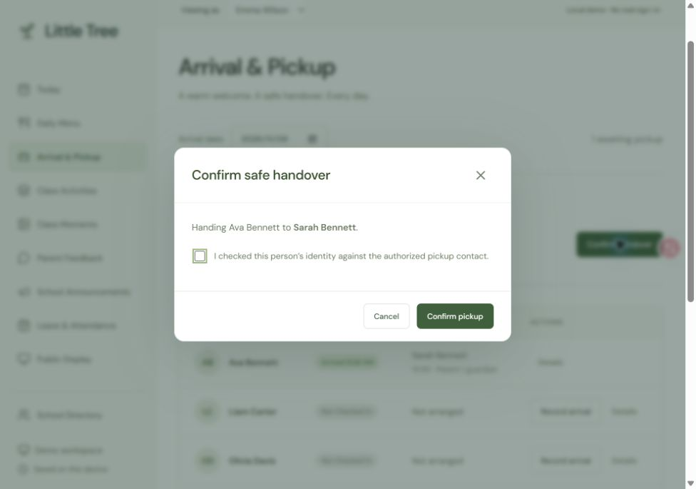

**Success:** the queue entry clears and the parent's row shows **Picked Up**, the confirming staff member, and the time. A completed handover remains as a record.

## Class Activities

### Teacher: share an activity

1. Open **Class Activities → Add activity**.
2. Enter the title, class, activity date, instructions, required materials, and any take-home task.
3. If a response is needed, request one and set its deadline.
4. Choose **Save Draft** to continue later or **Publish** to share with the class.

### Parent: respond from home

1. Read the activity, **Bring along**, and **A little task for home** sections.
2. Choose **Respond**, enter a short response or add a photo, and select **Submit response**. Use **Edit response** to update it while responses are allowed.
3. Teachers open the activity's response-count button to review submitted work.

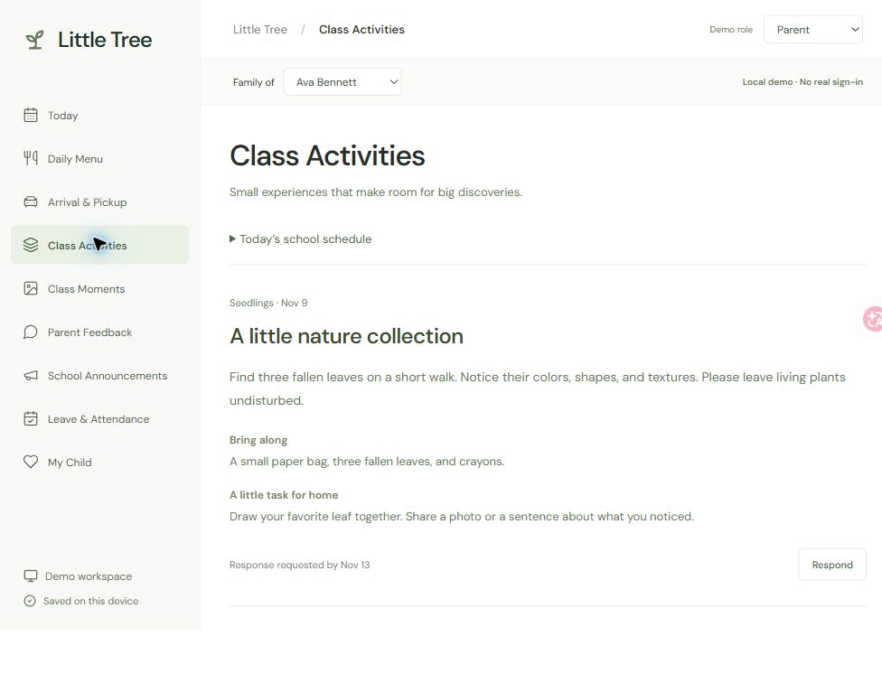

**Success:** the teacher can read the child's response. Other families cannot see that private response. Expand **Today's school schedule** on this page for general daily events.

## Class Moments

Class Moments is the class's private feed for stories, artwork, and classroom discoveries.

1. As a parent, open **Class Moments → Share a moment**. Add a title, a little story, and an optional photo.
2. Choose **Save Draft** or **Submit for review**. Track it under **My submissions**.
3. As the teacher, open **Review queue**. Select **Approve & Publish**, or **Request changes** and explain what needs attention.
4. Once published, families in the class can open the comments button, write a comment, and choose **Comment**.

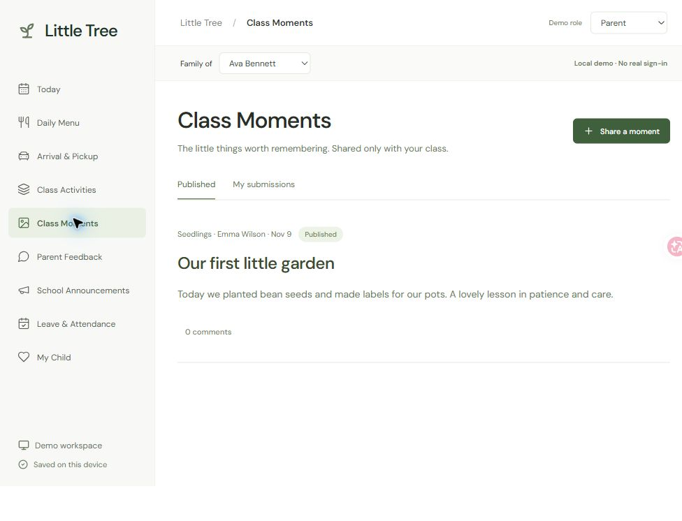

**Success:** a pending parent submission stays out of classmates' published feeds until approved. Editing a parent submission returns it to review. Class moments and their comments never appear on the public board.

## Parent Feedback

### Parent: start a private conversation

1. Open **Parent Feedback → New conversation**.
2. Enter a subject, choose Question, Suggestion, or Concern, and explain what you would like staff to know.
3. Submit the form, then open the conversation to read replies or send another message.

### Staff: reply and follow through

1. Open **Parent Feedback** and select a conversation. Use All, Open, In progress, or Resolved to filter the list.
2. Write in **Private reply**, then choose **Send reply**.
3. Set **Conversation status** to In progress while working on it, or Resolved when addressed.

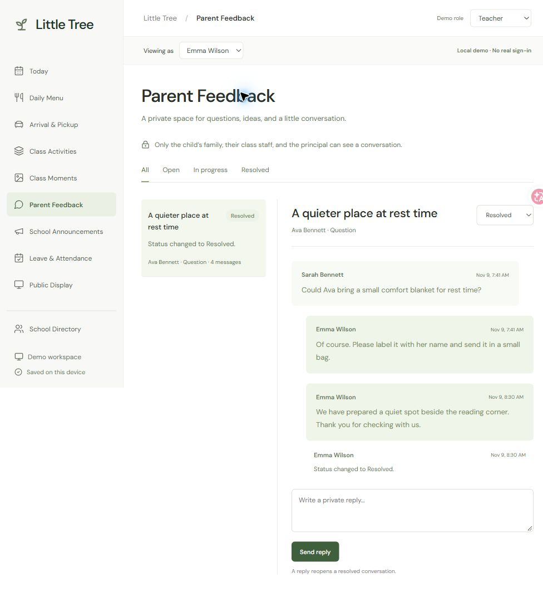

**Success:** replies and status changes stay in the conversation history after a reload. A reply reopens a resolved thread. Within the demo's role views, only that family, its class staff, and the principal can see the thread; it is never public or included on the TV.

## School Announcements

### Staff: publish now or schedule for later

1. Open **School Announcements → Add announcement**, or choose **Edit** on an existing notice.
2. Enter **Title**, **Audience**, and **Message**. Teachers publish to their assigned classes; principals can select **Whole kindergarten**.
3. Optionally select **Mark as urgent** and add an image or PDF attachment.
4. Under **Publication**, choose **Publish now**, then **Publish**; or choose **Schedule**, set **Publish at**, and select **Schedule**. Use **Save Draft** if it is unfinished.
5. Check the matching Published, Drafts, or Scheduled tab.

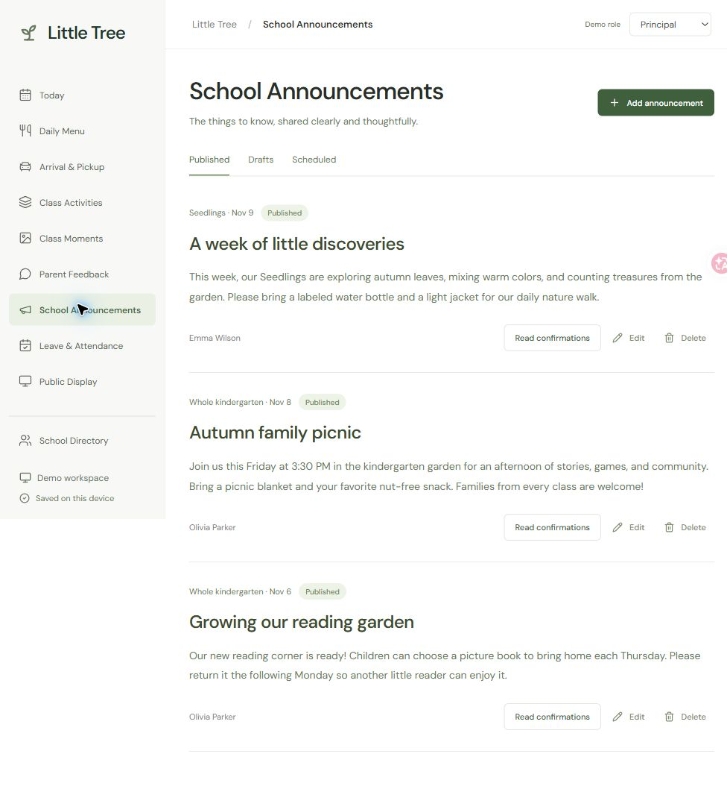

**Success:** the intended families see the published notice. A scheduled notice appears when due while a portal is open. The app checks every 15 seconds; background browser throttling can delay this. Schedule times use the device's local time.

Saving an already published announcement as a draft hides that notice from families until it is published again.

### Parent: acknowledge a notice

Read the notice and any attachment, then choose **Confirm read**. Staff use **Read confirmations** to see who acknowledged it. Editing a notice clears its earlier confirmations so families can acknowledge the new version.

### Principal: prepare a notice for the TV

For a whole-school announcement, enable **Approve a separate public version for the TV** and write a **Public title** and **Public message**. Keep them general: no student names, family details, or private information. Publish the notice, then select it on **Public Display**.

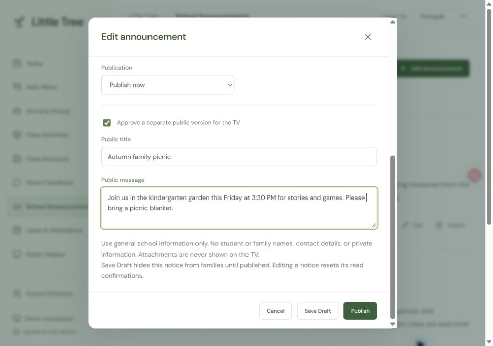

*The public message is written separately. The family message and attachments are not automatically copied to the TV.*

## Leave and Attendance

### Parent: request time away

1. Open **Leave & Attendance → Request leave**.
2. Choose the dates and leave type, explain the reason, and submit.
3. Check the status in the request list. A pending request can be cancelled with **Cancel request**.

Use valid school dates. Past dates, reversed ranges, weekend-only requests, periods longer than 31 days, and overlapping pending or approved requests are not accepted.

### Teacher: review and check attendance

1. Open **Leave & Attendance → Leave requests**.
2. Choose **Approve** or **Decline** and complete the review dialog. Declining requires an explanation.
3. Open **Attendance** and select the requested date.

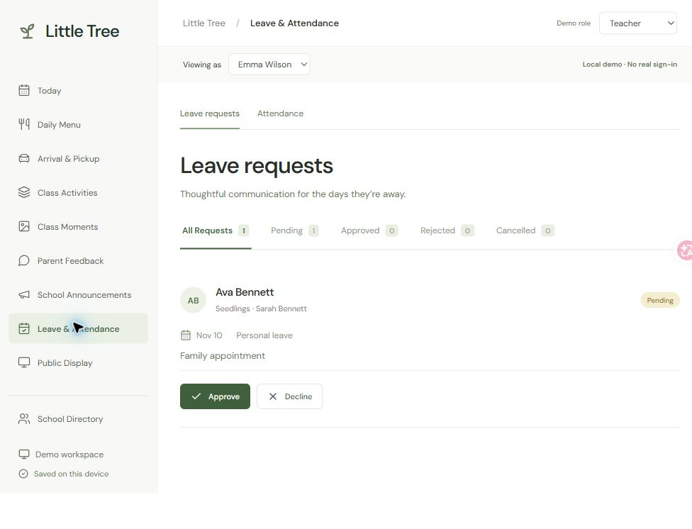

**Success:** approved leave appears as **Leave** in attendance. Manual attendance cannot overwrite it. Recorded arrivals also prevent conflicting leave approval or marking the child Absent/Unmarked. Reviewed leave decisions are final in this demo.

Parents can check decisions here and see recent attendance in **My Child**.

## School Directory and My Child

**Principals:** open **School Directory**. In **Classes**, add or edit class details, teacher assignments, and capacity. In **Students**, search or filter the roster, add or edit students, and open a child's profile. Archive a student when needed; use the **Archived** filter to find and restore archived records. Capacity checks help keep assignments consistent.

**Teachers:** use School Directory to view students in assigned classes.

**Parents:** open **My Child** for the selected child's class, teacher, family information, and recent attendance.

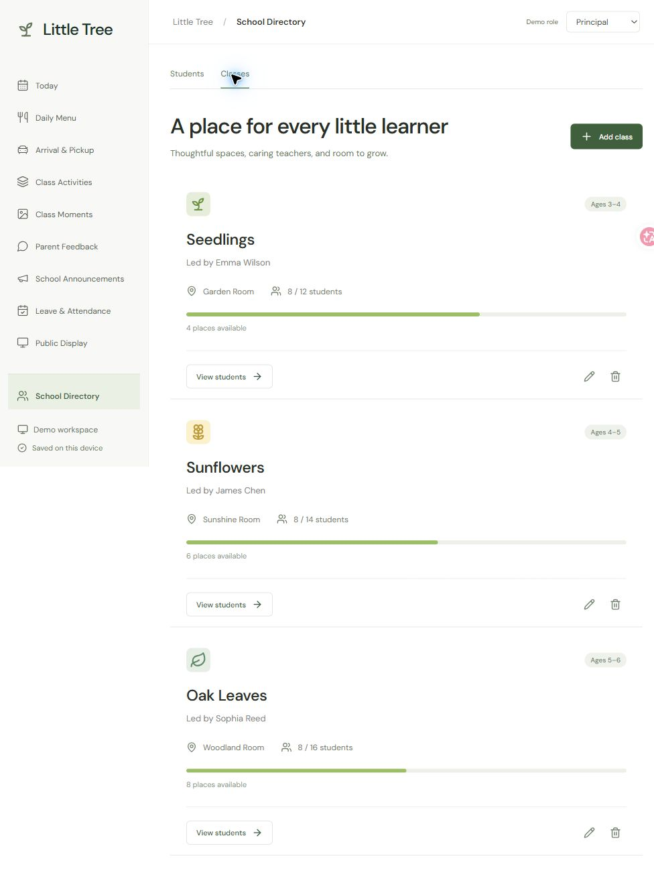

**Success:** class and student changes are reflected in the relevant staff and family views. Use fictional records while exploring the demo.

## Public Display

### Staff: choose what appears

1. Open **Public Display** from a staff view.
2. Enable **Show menu** to display today's published menu.
3. Set **Schedule date**. Use **Add schedule item**, **Edit**, or **Delete** to manage general school events, then select the events intended for the board. Today's schedule is also available under Class Activities in the parent portal.
4. Under **School notices**, select published whole-school notices with a principal-approved public version. If none appear, follow [the announcement steps](#school-announcements) first.
5. Choose **Open TV display**.

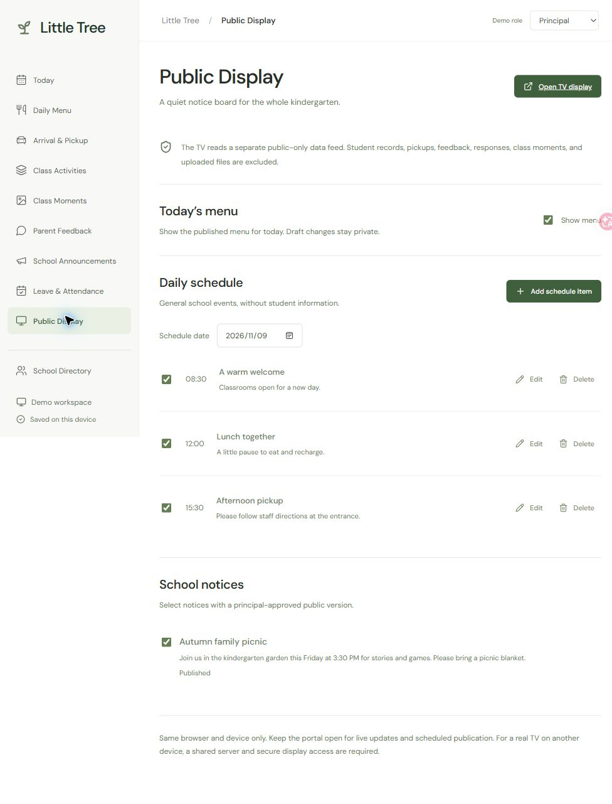

**Success:** the board shows the selected published menu, schedule, and public notices. Selection changes save immediately and update the board in the same browser profile.

### Put the board on a screen

1. Keep the portal open and open [the public board](http://127.0.0.1:5173/display.html) in the same browser profile.
2. If a TV is connected as a second monitor to this computer, move the board's browser window onto that monitor.
3. Choose **Full screen**, or use **F11** in Edge. Use **Esc** to leave app full screen, or **F11** again to leave browser full screen.
4. Check that all selected content fits at the actual display size. Choose fewer notices if needed; there is no automatic page rotation.

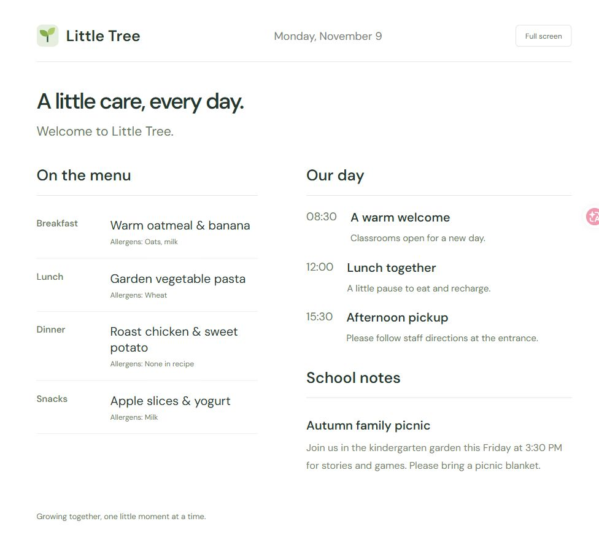

*The real notice board, captured with its published menu, selected schedules, and approved public announcement.*

**Keep in mind:** this demo cannot synchronize to a separate smart TV, phone, or computer. A TV acting as this computer's second monitor can show the same browser session. The board listens for local changes and refreshes every 15 seconds. At midnight in the school's America/Denver time zone, it stops showing yesterday's menu and schedules.

### Keep public content public

The board reads a separate public feed. Student profiles, pickup contacts, attendance, private feedback, activity responses, class moments, uploaded photos, and attachments are excluded. Staff must still review every public title, message, dish name, and schedule description for personal information. Automated text checks do not replace that review. The demo's shared browser storage is not a production security boundary.

## Saved progress

Changes save automatically when you complete a form or action. A normal reload keeps records, but resets the current page and demo role selection.

| To keep your progress | Why it matters |
| --- | --- |
| Use the same browser profile and `http://127.0.0.1:5173/`. | Another browser, profile, hostname, or port has separate storage. |
| Keep the browser's site data. | Clearing it removes records and uploaded files. Private browsing does not provide durable progress. |
| Keep a portal open alongside the TV. | The portal supplies public updates and processes scheduled publication. |
| Treat exported records as a reference copy. | **Demo workspace → Export records** contains JSON records and file references, not uploaded file contents. It is not a full backup, and import/restore is not implemented. |

There is no real authentication, central database, cross-device synchronization, email, or push delivery in this version. Reopening the project folder alone does not transfer browser data to a new computer.

## Help with common problems

| What you see | What to do | Success looks like |
| --- | --- | --- |
| “Open Little Tree with the local launcher” | Double-click `Start Little Tree.cmd`, then use the HTTP links above. | Today and the TV board render. |
| Node.js is missing or unsupported | Install Node.js LTS 22.12 or newer; reopen the terminal and launcher. | `node --version` reports a supported version. |
| “Dependencies are missing” | Open PowerShell in the project folder and run `npm.cmd ci`, then launch again. | The launcher reports ready. |
| Port 5173 belongs to another application | Close that application's local server if you own it, then retry. Little Tree deliberately does not stop it for you. | The launcher starts or identifies this same project. |
| Parent changes seem missing | Check the selected child, date, and publication status. Confirm you are using the same profile and exact address. | The intended published record appears. |
| TV is empty or missing a notice | Open the portal; enable today's menu or schedule. For a notice, publish and select its approved public version. Use the same profile and address. | Selected public content appears. |
| A photo will not save | Check the format and 8 MB limit, wait for processing, and read any storage error. | A preview appears before saving. |
| A form will not submit | Read its validation message, complete required fields, and check date/contact rules. | The dialog closes and a success message appears. |
| New application code is not visible | Stop the existing production server and relaunch so it rebuilds. Documentation edits do not require this. | The rebuilt application loads. |

## About the screenshots

All 14 images in this guide are actual browser captures of the working local app, taken in Microsoft Edge on **November 9, 2026**, with fictional demo records. The dish editor is a cropped detail of the real dialog; other captures show pages or dialogs. No placeholder or generated screenshot images are used. Dates and demo status may differ as you use the app.

The images live beside this guide in [`screenshots/`](screenshots/). Keep that folder with `USER_GUIDE.md` when copying the documentation. Open the file in a Markdown preview to see the pictures; a plain text editor shows their link syntax.

[Back to the README](README.md) · [Back to the guide contents](#find-your-way)
